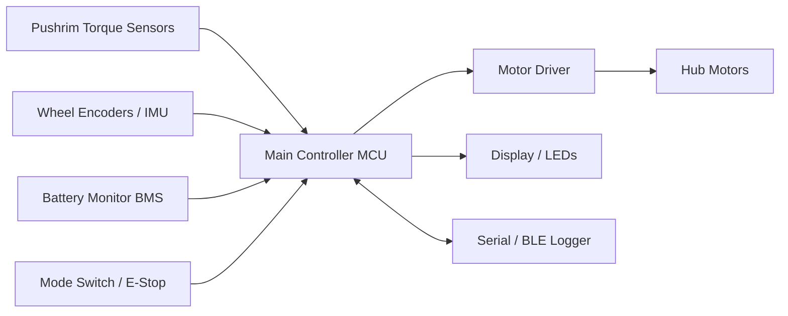
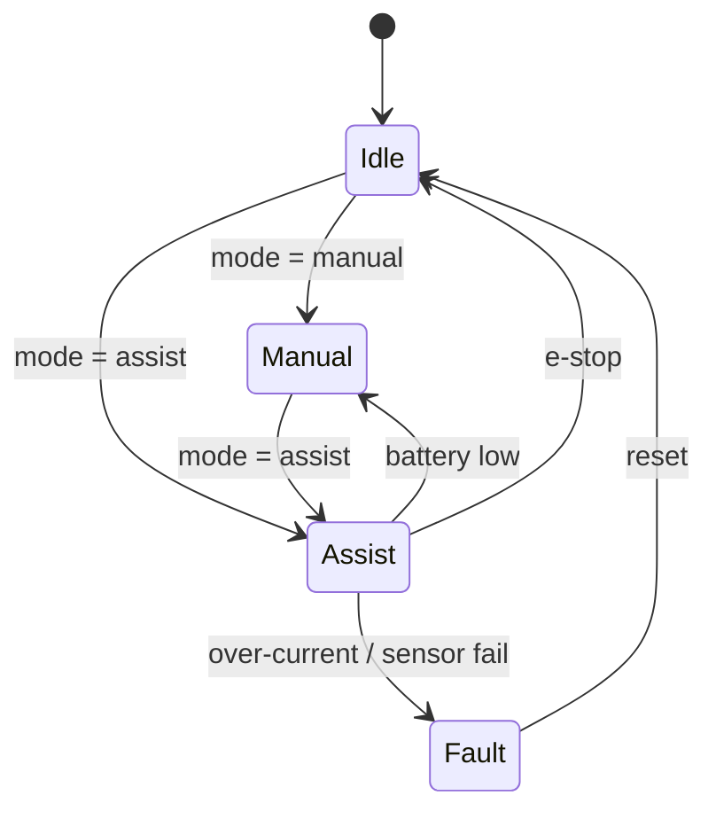
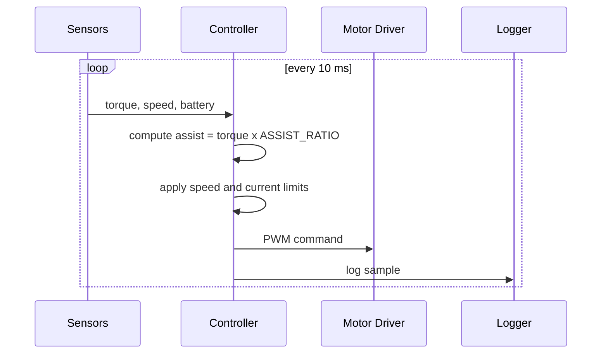

# Technical Design Document: Hybrid Wheelchair

## 1. Overview
A wheelchair that combines manual propulsion with motor assist. The controller reads pushrim torque and wheel speed, then commands the motors to add assist within safety limits.

**Goals:** reduce user fatigue, preserve a natural push feel, fail safe.
**Non-goals:** autonomous navigation (future work).

## 2. System Architecture

## 3. Control Flow

## 4. Data Flow

## 5. Components
| Component | Role |
|---|---|
| Torque sensors | Measure user push force |
| Encoders / IMU | Speed, direction, slope |
| MCU | Control loop (100 Hz) |
| Motor driver | Drives hub motors |
| Battery + BMS | Power, voltage/current reporting |
| E-stop | Immediate motor cutoff |

## 6. Control Logic
- `assist_cmd = clamp(torque * ASSIST_RATIO, 0, MAX_ASSIST)`
- Assist drops to 0 as speed reaches `MAX_SPEED_KMH`.
- Assist fades out when battery < `BATTERY_LOW_PCT`.
- Current above `MAX_CURRENT_A` triggers Fault.

## 7. Safety Requirements
1. E-stop cuts motor power within 100 ms.
2. Sensor loss triggers Fault and disables assist.
3. Speed never exceeds the configured limit.
4. Motor never starts without user input (no runaway).
5. Brake or coast behavior is defined for every fault.

## 8. Interfaces
Serial CSV at 115200 baud: `timestamp_ms,torque_nm,speed_kmh,battery_pct,current_a,mode`

## 9. Testing Strategy
Unit tests for control logic, replay of sample logs, hardware-in-loop bench tests, then supervised field tests. See `tests/TEST_CASES.md`.

## 10. Risks
| Risk | Mitigation |
|---|---|
| Sensor noise causes jerky assist | Low-pass filter, deadband |
| Battery brownout | Early fade-out, voltage cutoff |
| Unexpected motor motion | Torque threshold gate, e-stop |

## 11. Future Work
Slope-aware assist, app control, regenerative braking.
